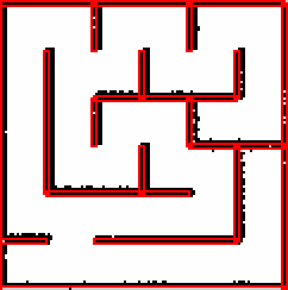

# IE4060 Assignment 02: extended technical notes

> Long-form companion to `final_report.md` (the submitted 5–7 page report). It keeps the full
> mapping comparison, debugging details and measurements that did not fit the page limit.

## Autonomous Navigation of TurtleBot3 Burger in Gazebo (ROS 2 Jazzy)

**Student Name:** Seneth Jayathilaka  
**Degree Programme:** BSc (Hons) in Information Technology / Computer Systems Engineering  
**Department:** Computer Systems Engineering, Faculty of Computing  
**Institution:** Sri Lanka Institute of Information Technology (SLIIT)  
**Date:** October 2026  
**GitHub Repository:** TODO-REPO-LINK  
**ROS Distribution:** ROS 2 Jazzy Jalisco  
**Simulator:** Gazebo Sim Harmonic  

> Every number in Sections 3, 4.5, 5.4 and 6 comes from a logged run. The Nav2 Dijkstra and A*
> results in Section 6.2 are taken from `docs/test_summary.csv` (per-trial data in
> `docs/test_results.csv` and `docs/raw_trials.csv`). The mapping comparison (Section 3.3) and
> the long-route drives (Section 4.5) were measured during development with the scripts in this
> repository; their raw logs are not committed.

---

## 1. Introduction and Objectives

This project builds a complete navigation pipeline for a TurtleBot3 Burger in a 6 × 6 maze
(0.5 m cells, 3 m × 3 m arena) reproducing Figure 1 of the assignment brief:

1. A Gazebo Harmonic world of the maze, with the Burger spawned and bridged to ROS 2 (`maze_world`).
2. A 2D occupancy-grid map of the maze built with SLAM Toolbox (`maze_navigation`).
3. Autonomous navigation with Nav2 using the NavFn global planner in Dijkstra and A* modes,
   the Regulated Pure Pursuit local controller and AMCL localisation (`maze_navigation`).
4. Clicked-goal navigation from RViz and an automated 3-goal demonstration with built-in
   measurement of travel time, path length and collisions (`goal_interface`).
5. A Deep Q-Network (DQN) navigation agent trained in a 2D kinematic model of the maze and
   deployed as a ROS 2 node (`maze_dqn`).
6. A quantitative comparison of the three methods on the same goals.

---

## 2. Maze Design and Simulation

### 2.1 Geometry
The world origin is the centre of the arena, so x, y ∈ [−1.5, 1.5] m and cell centres lie at
±0.25, ±0.75 and ±1.25 m. Walls are static boxes 0.05 m thick and 0.50 m high (taller than the
Burger's 0.192 m LiDAR mount, so every wall is seen by the scanner). Collinear wall segments
were merged into 18 boxes (7 horizontal, 11 vertical), all defined directly in
`maze_world/worlds/maze.world`.

```
+---+---+---+---+---+---+
|       |       |       |
+   +   +   +   +   +   +
|   |       |       |   |
+   +   +---+---+---+   +
|   |   |       |       |
+   +   +   +   +---+---+
|   |       |       |   |
+   +---+---+---+   +   +
|                   |   |
+---+   +---+---+---+   +
|     S                 |
+---+---+---+---+---+---+
```
*Figure 1 — Maze layout generated from the wall geometry used in Gazebo and in the DQN
training environment (S = spawn at (−0.75, −1.25)).*

A breadth-first search over the cell graph derived from these walls finds all 36 cells reachable
through 35 openings, so the maze is a "perfect" maze: exactly one corridor route between any
two cells. Corridors are 0.45 m wide between wall faces. With the Nav2 footprint radius of
0.10 m, a robot on the corridor centre line has 0.125 m clearance on each side.

### 2.2 Simulation Bring-up
`maze_world.launch.py` follows the structure of `turtlebot3_gazebo/turtlebot3_world.launch.py`
for Jazzy: it appends the TurtleBot3 model directory to `GZ_SIM_RESOURCE_PATH`, starts the
Gazebo server (and optionally the GUI) with `maze.world`, includes TurtleBot3's
`robot_state_publisher.launch.py`, and includes `spawn_turtlebot3.launch.py`, which spawns the
Burger at (−0.75, −1.25) and starts `ros_gz_bridge` for `/clock`, `/scan`, `/odom`, `/tf`, `/imu`,
`/joint_states` and `/cmd_vel`. The world loads the Gazebo system plugins Physics,
UserCommands, SceneBroadcaster, Sensors (ogre2 render engine, needed by the GPU LiDAR) and
Imu. Without the Sensors plugin the LiDAR does not publish at all.

The TurtleBot3 Jazzy bridge maps `/cmd_vel` as `geometry_msgs/msg/TwistStamped`
(verified in WSL: `ros2 topic info /cmd_vel` reports `geometry_msgs/msg/TwistStamped`). All Nav2 servers
therefore run with `enable_stamped_cmd_vel: true`, and the DQN node publishes TwistStamped by
default.

---

## 3. Mapping (SLAM) and Localisation

### 3.1 Frames
`odom → base_footprint` comes from the Gazebo DiffDrive plugin, `base_footprint → base_link →
base_scan` from `robot_state_publisher`, and `map → odom` from AMCL while navigating.

While mapping, SLAM Toolbox uses a second, separate tree published by
`maze_navigation/scripts/imu_odom.py`: `odom_imu → base_footprint_imu → base_scan_imu`, with
`/scan` republished as `/scan_imu` on that frame, and SLAM Toolbox publishes `map → odom_imu`
(Section 3.2). Nav2, AMCL and the DQN node only ever use the normal `odom` tree.

### 3.2 Mapping procedure
SLAM Toolbox (online asynchronous mode, `slam.launch.py` with `config/slam_params.yaml`) was
run while `scripts/explore_maze.py` drove the robot through every one of the 36 cells. The
script does a depth-first traversal of the cell graph (taken from `maze_dqn.maze_env`),
backtracking at dead ends, so every wall is seen from close range. Motion is stop–turn–drive
with ramped, slow commands (turns ≤ 0.3 rad/s), because in this Gazebo world the Burger's
wheels slip on fast in-place turns: a 90° turn at 1.2 rad/s loses about 12° that odometry
never sees, while turns at ≤ 0.5 rad/s lose less than 1°. Between moves the script re-anchors
its own steering to the Gazebo ground-truth pose (`gz model -m burger -p`), so odometry drift
never steers the robot into a wall. That pose is used only for steering. It is never published
to ROS, and the map is built only from the robot's own sensors (wheel encoders, IMU, LiDAR).

**Odometry for mapping.** Even with slow turns, the wheel odometry loses about 3° of heading on
every 90° turn in this world (an effective wheel-track mismatch in the simulated contact). Over
a 7-minute exploration it drifted 0.44 m and 18° from the true pose. The simulated IMU gyro is
far more accurate: after a series of fast and slow turns, the integrated gyro was 0.1° off
the true heading, against 6.2° for the wheel odometry. `imu_odom.py` therefore integrates the
wheel forward speed (`/odom` twist) with the gyro yaw rate (`/imu`) and publishes the result on
the separate `odom_imu` tree (Section 3.1). Over the same 7-minute exploration it stayed within
4 cm of the true position with no heading drift. `slam.launch.py` starts it together with SLAM
Toolbox.

**SLAM settings.** `config/slam_params.yaml` is SLAM Toolbox's stock
`mapper_params_online_async.yaml` with these changes:
- the `odom_imu` / `base_footprint_imu` frames and the `/scan_imu` topic;
- `max_laser_range` 20.0 → **1.5 m**, so only nearby walls are drawn and a small heading error
  cannot smear walls on the far side of the 3 m maze;
- `resolution` 0.05 → **0.025 m**. The walls are only 5 cm thick, so on a 5 cm grid each wall
  is a single cell and the grid alone can misplace it by up to a cell;
- `use_scan_matching` and `do_loop_closing` **off**. In this repetitive maze the scan matcher
  regularly registered scans one wall-thickness off, which doubled walls and dropped parts of
  the outer wall (Section 3.3). With odometry this accurate, the map is better built directly
  from the odometry poses. The map itself is still built entirely from `/scan`.

The map was saved with `nav2_map_server map_saver_cli` at 0.025 m/pixel.

**Map frame alignment and padding.** SLAM Toolbox places its map origin at the robot's first
odometry pose, i.e. at the spawn pose. To make map coordinates equal Gazebo world coordinates,
the saved map's `origin` was shifted by the spawn position (−0.75, −1.25) using
`scripts/align_map_origin.py` (the spawn yaw is 0, so no rotation is needed). As a result the
AMCL initial pose is simply the spawn pose, and the VIVA goals and the `goal_manager` bounds
check (|x|, |y| ≤ 1.45 m) are written directly in world coordinates. The map is then padded with
a 2.5 m border of unknown cells by `scripts/pad_map.py`; the mapped cells and their coordinates
are unchanged. Section 4.4 explains why.

  
*Figure 2 — The occupancy grid built by SLAM Toolbox (black), before padding, with the true wall
outlines from `maze.world` drawn in red (`docs/slam_map_vs_true_walls.png`).*

### 3.3 Map quality
Map quality was scored against the known wall geometry of `maze.world` by checking each
occupied pixel's distance to the nearest true wall, and each wall face (sampled every 2.5 cm)
for a mapped pixel within 7.5 cm. All runs used the same exploration route and motion
(`scripts/explore_maze.py`):

| Run | Odometry | Scan matching | Mean error (cm) | Pixels ≤ 10 cm | Wall faces mapped | Stray pixels (> 7.5 cm) |
| :-- | :-- | :-: | :-: | :-: | :-: | :-: |
| 1 | wheel | on | 2.1 | 96.2 % | 97.3 % | 37 |
| 2 (same settings as 1) | wheel | on | 4.0 | 91.4 % | 88.6 % | 212 |
| 3 (range 2.0 m) | wheel | on | 3.5 | 90.1 % | 89.7 % | 156 |
| 4 (0.025 m resolution) | wheel | on | 4.5 | 83.2 % | 82.1 % | 654 |
| 5 | wheel + gyro | on | 6.0 | 75.2 % | 76.1 % | 320 |
| 6 | wheel + gyro | on | 3.3 | 95.2 % | 93.0 % | 147 |
| 7 | wheel + gyro | on, 10× odometry prior | 3.4 | 93.9 % | 89.0 % | 151 |
| 8 | wheel + gyro | off | 2.4 | 100 % | 99.9 % | 4 |
| **9 (installed map, 0.025 m grid)** | **wheel + gyro** | **off** | **1.8** | **100 %** | **100 %** | **5** |

With scan matching on, map quality varied widely from run to run, even with identical settings
(runs 1 and 2). The previous installed map (run 1) was the best of those, but it was still
missing a 0.7 m stretch of the east outer wall and had a doubled wall in the dead-end cell
(0.75, 0.25); both made Nav2 fail on the right side of the maze. Runs 8 and 9 (same
settings, 5 cm and 2.5 cm grid) have every wall, no doubled walls and only 4–5 stray pixels.
Runs 1–8 used a 5 cm grid.

- Installed map: 121 × 122 pixels (3.03 m × 3.05 m) at 0.025 m/px before padding, 321 × 322
  after (`src/maze_navigation/maps/maze_map.pgm`).
- 95th-percentile error 5.8 cm, 86.8 % of wall pixels within 5 cm (65.9 % on the 5 cm grid) and
  every wall pixel within 10 cm.
- **Remaining offset:** the map still sits about 2–4 cm towards +x and +y of the true walls
  (5 cm grid: 3–5 cm). Halving the cell size shrank it, so most of it is grid quantisation:
  the laser only hits the face of a wall that points at the robot, and that face falls at an
  arbitrary position inside a grid cell. The LiDAR mount matches between the Gazebo model and
  the TF tree (x = −0.032 m), the raw ranges are accurate (mean −0.6 cm against ray-cast true
  distances) and SLAM's `map → odom` transform is the identity at start. The remainder was not
  corrected, because that would mean fitting the map to the ground-truth walls.

### 3.4 Localisation (AMCL)
AMCL uses the likelihood-field model (max range 3.5 m), 500–2000 particles and
differential-drive motion noise α₁…α₅ = 0.2. The laser model is sharper than the TurtleBot3
default: `sigma_hit` 0.08 (default 0.2), `z_rand` 0.2 (default 0.5) and 120 beams (default 60).
With the default model the 0.45 m corridors constrain the estimate too weakly and it drifted by
about 0.35 m. `set_initial_pose: true` places the initial pose at the spawn pose
(−0.75, −1.25, 0), so no manual "2D Pose Estimate" is required.

---

## 4. Navigation with Nav2

### 4.1 Global planning: Dijkstra vs A*
The NavFn planner (`nav2_navfn_planner::NavfnPlanner`) computes a navigation function over the
global costmap. With `use_astar: false` it expands a Dijkstra wavefront (f = g); with
`use_astar: true` it adds a Euclidean heuristic (f = g + h). Both are optimal on the same
costmap, so path *length* should be nearly identical. A* only reduces the number of expanded
cells. The mode is selected at launch with `navigation.launch.py use_astar:=true|false`, which
rewrites the parameter through `nav2_common.RewrittenYaml`. For the A* benchmark runs,
`use_astar: True` was confirmed on the running `planner_server`.

### 4.2 Local control: Regulated Pure Pursuit instead of DWB
The first configuration used the TurtleBot3 default DWB controller. In the 0.45 m corridors DWB
cut corners and scraped walls. It was replaced by the Regulated Pure Pursuit (RPP) controller,
which follows the corridor-centred global path with a short lookahead (`lookahead_dist` 0.15 m,
range 0.12–0.25 m) and a desired speed of 0.15 m/s. With such a short lookahead it does not cut
the inside of 90° turns. When the path heading changes by more than 0.6 rad, RPP stops and pivots
in place at a fixed 0.5 rad/s (`rotate_to_heading_angular_vel`). That speed is below the
wheel-slip threshold measured in Section 3.2.

The slip measurement also set the remaining angular limits. Fast in-place turns made AMCL lose
the robot, so the velocity smoother limits |ω| to 1.0 rad/s with 2.0 rad/s² acceleration, RPP
limits angular acceleration to 1.0 rad/s², and recovery spins in the behaviour server run at
0.4–0.6 rad/s. Goal tolerance is 0.10 m in position (goals are cell centres 0.5 m apart) and
0.25 rad in yaw. The Jazzy bring-up also runs the collision monitor, configured with only a
0.10 m emergency-stop circle, because slow-down zones would trigger constantly in 0.45 m
corridors.

### 4.3 Costmap tuning for 0.45 m corridors
The robot radius is 0.10 m. The inflation layer uses `inflation_radius: 0.30` and
`cost_scaling_factor: 6.0` in both costmaps. On the corridor centre line (0.225 m from both
walls) the inflated cost is well below lethal, so no corridor is closed. The cost rises
steeply towards the walls, which pulls planned paths onto the centre line. The TurtleBot3
default (0.5 m inflation) leaves no low-cost channel in a 0.45 m corridor.

**Static-only global costmap.** The global costmap originally also had an obstacle layer fed by
`/scan`. Live scan hits land a few centimetres off the SLAM walls, and once inflated by the robot
radius they sealed whole corridors, so the planner found no path. Because the maze is static and
fully mapped, the global costmap now uses only the static and inflation layers. The local
costmap keeps its `/scan` obstacle layer, so unexpected obstacles are still seen by the
controller.

### 4.4 Long routes: NavFn's path-length limit
With the first working configuration, every goal more than about 6 m of driving away failed,
while the three VIVA goals (at most 6.2 m) worked. Planning requests sent directly to the
planner showed the pattern: from one start point, goals 5.8 m and 6.6 m away were planned,
goals 7.5 m and further were not. The same far goals planned fine from a closer start point, so
they were reachable. A finer global costmap, an upsampled map and weaker inflation costs did
not move the limit. The cause is how NavFn extracts the path: after computing its potential
field it traces the path back in half-cell steps, and it stops after 4 × (costmap width in
cells) steps. A path can therefore be at most about twice the costmap width in metres
(2 × 3.1 m ≈ 6.2 m here), while the longest route in this maze is about 12 m.

The global costmap takes its size from the map, so `scripts/pad_map.py` adds a 2.5 m border of
unknown cells around the saved map. That makes it 8.1 m wide and raises the limit to about
16 m, without changing any mapped cell. NavFn's `allow_unknown` is set to `false`, so no path
can run through the border. After the change, plans of 8.3–10.0 m succeeded with both
Dijkstra and A*, including the worst-case route.

### 4.5 Long-route test
The robot drove two goal sequences with each planner:
spawn → (1.25, −0.25) → dead-end cell (0.75, 0.25) → (1.25, −0.25), and
spawn → (1.25, 0.25) → (1.25, −0.25) → (1.25, 0.25). Every leg after the first is a 9.4–9.9 m
route around most of the maze; (1.25, 0.25) and (1.25, −0.25) are adjacent cells separated by
a wall.

- **Installed map (2.5 cm grid):** 11 of 12 legs reached their goal (final error 0.07–0.11 m).
  The failure was the A* leg spawn → (1.25, 0.25): the robot touched a wall on the way, stopped
  1.03 m short, and Nav2 aborted; the two following legs of that sequence then succeeded. All
  other legs kept at least 0.129 m LiDAR clearance.
- **Same test on the 5 cm map of the same pipeline (run 8):** 16 of 18 legs (the first Dijkstra
  sequence was repeated twice more), no wall contact. The two failures came from one stop
  0.28 m short of the dead-end cell; both repeats completed every leg.
- Before the map padding and the remap, every one of these long goals failed.

### 4.6 Goal interfaces
- **RViz:** "Nav2 Goal" sends a goal to Nav2's action server. "2D Goal Pose" publishes
  `/goal_pose`, which both Nav2 and the DQN node accept. "Publish Point" goals are forwarded by
  `goal_manager` after a bounds check.
- **`viva_demo`:** sends three goals in sequence: G1 (−0.25, −0.75), G2 (0.75, 0.75),
  G3 (1.25, 1.25). For each leg it records the sim-time travel time, the path length summed from
  `/odom`, collision events and the minimum LiDAR range, and it appends the row to a CSV.

---

## 5. Deep Q-Learning Navigation

### 5.1 Training environment
Training runs in `maze_env.py`, a 2D kinematic model of the same 18 walls. It integrates
unicycle kinematics at 10 Hz and ray-casts a 360-ray, 1° LiDAR, which is min-pooled into 36
sectors of 10°. Pooling the minimum of each sector, rather than taking one ray every 10°,
matters because a thin wall end can otherwise fall between two beams. A step counts as a
collision when the robot centre comes within 0.12 m of a wall.

### 5.2 MDP
- **State (39-D):** 36 sector ranges (clipped at 1.5 m and normalised), distance to the target
  (÷ 4.24 m), bearing to the target (÷ π) and the previous action.
- **Actions:** forward (0.18, 0), rotate left / right in place (0, ±1.0 rad/s), soft left /
  right (0.14, ±0.35).
- **Reward:** +30 at the goal (d < 0.15 m), −20 for a collision, −5 at timeout, and otherwise
  10 × (decrease in maze-path distance to the goal) − 0.05, plus −0.2 within 0.18 m of a wall.
  The progress term uses the distance *along the maze corridors* (cell-graph shortest path),
  not the straight-line distance, so that moving towards a goal behind a wall is not rewarded.
- **Two variants:** (a) *final-goal DQN*, where the target in the state is the goal itself;
  (b) *subgoal DQN*, where the target is the centre of the next cell on the shortest grid path,
  i.e. the DQN is a learned local controller under a grid route planner.

### 5.3 Learning algorithm
Double DQN with a NumPy MLP (39-128-128-64-5, ReLU), Huber loss, Adam (lr 5×10⁻⁴), γ = 0.98,
batch 64, a 100 000-transition replay buffer, and a hard target update every 1000 steps.
ε decays from 1.0 by 0.998 per episode to 0.05. The curriculum starts with goals one cell
away and raises the maximum cell distance whenever 70 % of the last 100 episodes at the current
level succeed. Every 100 episodes the greedy policy is evaluated on the three test goals and
on 50 random full-maze start/goal pairs; the best evaluation's weights are kept.

**Why the original agent failed (0 % success, 100 % collisions in all 400 episodes).**
1. ε was multiplied by 0.992 after every gradient step rather than every episode, so
   exploration effectively ended after about 300 steps (episode 2–3).
2. Episodes were capped at 300 steps (5.4 m at full speed), shorter than the 6.5–7.5 m
   corridor routes to the far goals.
3. The sharpest turn still moved forward at 0.08 m/s (turning radius 0.107 m). A robot facing a
   wall in a 0.45 m corridor could not turn around without entering the 0.12 m collision zone.
4. The progress reward used straight-line distance, which rewards driving into walls when the
   goal lies behind them.

### 5.4 Training results (2D environment)
Greedy evaluation of the saved weights (`src/maze_dqn/models/dqn_final_evaluation.csv`):

| Variant | Goal A | Goal B | Goal C | Random pairs 1–2 cells | 3–5 cells | 8–10 cells | 22–24 cells |
| :-- | :-: | :-: | :-: | :-: | :-: | :-: | :-: |
| Final-goal DQN | 0/1 (collision) | 0/1 | 0/1 | 39/50 | 16/50 | 0/50 | 0/50 |
| Subgoal DQN | 0/1 | 1/1 | 1/1 | 44/50 | 30/50 | 25/50 | 22/50 |

Goals A, B and C are G1, G2 and G3 of Section 6, from the spawn.

Training curves: `dqn_training_log.csv` / `dqn_eval_log.csv` (final-goal) and
`dqn_subgoal_training_log.csv` / `dqn_subgoal_eval_log.csv` (subgoal).
Final-goal DQN: 3000 episodes, reaching curriculum level 4 (goals up to 4 cells away). It never
solved a test goal in any evaluation; it handles goals 1–2 cells away (78 %) but not goals
behind walls, where it typically rotates left and right in place, a local minimum of a purely
reactive policy.
Subgoal DQN: trained for 2200 episodes (stopped at the time-box) and reached curriculum level 10.
The kept checkpoint is its best evaluation, first reached at episode 1300 (2/3 test goals,
38 % of random full-maze pairs); later evaluations were worse, so training became unstable at
the higher curriculum levels.

### 5.5 Deployment
`dqn_navigation_node` builds the same 39-D state from `/scan` (same sector pooling) and from the
robot pose in the `map` frame (TF `map → base_footprint`). It publishes TwistStamped commands at
10 Hz. Goals arrive on `/goal_pose`, so a goal can be clicked with RViz's **2D Goal Pose** tool.
The pose comes from AMCL, started without the rest of Nav2 by `localization.launch.py`
(map server + AMCL only), because Nav2's `bt_navigator` would also react to `/goal_pose`. With
`odom:=imu`, AMCL uses the wheel + gyro odometry of `imu_odom.py` (Section 3.2) instead of the
wheel odometry, which matters for the DQN because its wall contacts and fast in-place turns make
the wheels slip. With the gyro odometry AMCL stayed within 0.19 m of the true pose in every DQN
run. Without any map frame the node falls back to raw wheel odometry plus the spawn offset, which
is not usable here: in a run where the map failed to load, the DQN steered by that fallback pose
ended 0.5–2.5 m from goals it believed it had reached.

---

## 6. Results

> **Earlier protocol.** The numbers in this section use the first measured protocol: legs were
> chained (each started where the previous one ended) and the reference length was the route
> through the cell centres, so efficiencies exceed 100 %. The submitted report (`final_report.md`)
> uses the replacement protocol: fixed starts for every leg and the shortest safe path as the
> reference, plus the DQN safety-shield variant.

### 6.1 Protocol and metrics
For each method, `viva_demo` runs the sequence G1 → G2 → G3 three times (9 legs per method).
Each leg starts where the previous one ended. The recorded start pose is used to compute the
reference length.
- **Travel time** T: simulation time from sending the goal to the result.
- **Path length** L: sum of `/odom` displacements during the leg.
- **Reference length** L_ref: start → centres of the intermediate cells on the shortest cell
  path → goal (`scripts/collect_metrics.py`).
- **Path efficiency** η = L_ref / L × 100 %.
- **Collision event:** the minimum valid LiDAR range drops below 0.12 m. The Burger LiDAR's
  `range_min` is 0.12 m and closer returns are reported as −inf, which are counted as
  collisions.
- **Minimum clearance:** the smallest valid LiDAR range over all trials of a goal.

Goals: G1 (−0.25, −0.75) "Corridor Junction", G2 (0.75, 0.75) "Central Passage",
G3 (1.25, 1.25) "Far Maze Destination". Trial 1 starts at the spawn (−0.75, −1.25).

### 6.2 Results (mean ± sample std over successful trials)
| Method | Goal | Success | Time (s) | Path (m) | Ref (m) | η (%) | Collisions | Min clearance (m) |
| :-- | :-- | :-: | :-: | :-: | :-: | :-: | :-: | :-: |
| Nav2 Dijkstra | G1 | 3/3 | 62.63 ± 40.83 | 4.23 ± 3.01 | 5.27 ± 3.69 | 126.6 ± 4.4 | 0 | 0.165 |
| Nav2 Dijkstra | G2 | 3/3 | 81.32 ± 3.05 | 5.21 ± 0.01 | 6.40 ± 0.01 | 123.0 ± 0.3 | 0 | 0.141 |
| Nav2 Dijkstra | G3 | 3/3 | 10.86 ± 0.57 | 0.76 ± 0.02 | 0.99 ± 0.01 | 130.5 ± 3.2 | 0 | 0.153 |
| Nav2 A* | G1 | 3/3 | 61.35 ± 39.47 | 4.16 ± 2.94 | 5.27 ± 3.70 | 127.8 ± 2.5 | 0 | 0.153 |
| Nav2 A* | G2 | 3/3 | 82.22 ± 0.90 | 5.13 ± 0.03 | 6.40 ± 0.01 | 124.9 ± 0.6 | 1 | 0.120 |
| Nav2 A* | G3 | 3/3 | 10.86 ± 0.43 | 0.75 ± 0.00 | 0.99 ± 0.01 | 132.8 ± 1.1 | 0 | 0.164 |
| DQN subgoal | G1 | 3/3 | 68.71 ± 50.10 | 4.11 ± 2.94 | 5.25 ± 3.68 | 131.6 ± 7.6 | 24 | 0.000 |
| DQN subgoal | G2 | 3/3 | 66.03 ± 4.31 | 5.14 ± 0.05 | 6.38 ± 0.01 | 124.0 ± 1.2 | 26 | 0.000 |
| DQN subgoal | G3 | 3/3 | 9.57 ± 1.12 | 0.74 ± 0.05 | 0.98 ± 0.01 | 133.2 ± 8.2 | 4 | 0.000 |
| DQN final goal | G1 | 2/3 | 44.40 ± 53.03 | 1.38 ± 1.15 | 2.17 ± 1.03 | 148.1 ± 41.8 | 42 | 0.000 |
| DQN final goal | G2 | 0/3 | n/a | n/a | 5.67 ± 1.46 | n/a | 95 | 0.000 |
| DQN final goal | G3 | 0/3 | n/a | n/a | 5.83 ± 0.04 | n/a | 69 | 0.000 |

*Source: `docs/test_summary.csv` (per-trial data in `docs/test_results.csv`; raw `viva_demo`
output in `docs/raw_trials.csv`), all on the installed 2.5 cm map. Collisions are summed over the
three trials. In the first DQN-subgoal leg `viva_demo` had no pose yet when it sent the goal;
that leg's start was filled in as the spawn pose, where every trial 1 starts (`viva_demo` now
waits for a pose).*

**How the DQN runs were set up and judged.** The DQN node and `viva_demo` take the robot pose
from AMCL (`localization.launch.py odom:=imu`, Section 5.5). A DQN leg counts as reached when that
pose is within 0.15 m of the goal, and fails after 180 s. Because AMCL can be wrong, every DQN leg
was also checked against the Gazebo ground-truth pose (measurement only; the robot never sees
it). AMCL stayed within 0.19 m of the true pose throughout, and every subgoal-DQN leg that the
truth log captured ended 0.15–0.18 m from the goal, so its successes are real. An earlier DQN run,
in which the localisation launch silently failed to load the map, reported impossible successes
(the true robot was 0.5–2.5 m away); it was discarded.

All 18 Nav2 legs (3 trials × 3 goals × 2 planners) and all 9 subgoal-DQN legs reached their goal;
the final-goal DQN reached 2 of 9.

**Why η exceeds 100 %.** The reference length L_ref is the route through the *centres* of the
cells on the shortest cell path. At every 90° bend the robot turns before reaching the cell
centre, so it cuts the corner and its odometry path is shorter than the reference. η = L_ref / L
is therefore above 100 % for every leg (122.7–134.0 % per Nav2 trial, 123.2–142.7 % per
subgoal-DQN trial in `docs/test_results.csv`). It measures how much shorter than the cell-centre
route the robot drove, not an error in the data. The final-goal DQN values are not comparable:
its successful legs started wherever earlier failed legs had left the robot.

**Why G1 has a large spread.** Each sequence is G1 → G2 → G3, and each leg starts where the
previous one ended. In trial 1, G1 starts at the spawn (−0.75, −1.25), one cell away
(L_ref = 1.00 m, 12–16 s). In trials 2 and 3, G1 starts at G3 from the previous sequence
(≈ (1.15, 1.25)), on the far side of the maze (L_ref ≈ 7.40 m, 83–108 s). The ± values for G1
therefore reflect two different start positions, not inconsistent behaviour. G2 and G3 always
start from about the same place, and their spreads are small.

### 6.3 Discussion
- **Dijkstra vs A*:** both planners are optimal on the same costmap and the robot followed the
  same corridor routes with both. Mean path lengths differ by at most 0.08 m per goal (G1 4.23
  vs 4.16 m, G2 5.21 vs 5.13 m, G3 0.76 vs 0.75 m), and mean times are within the
  trial-to-trial spread (G1 62.63 vs 61.35 s, G2 81.32 vs 82.22 s, G3 10.86 vs 10.86 s). In a
  maze this small, A*'s smaller search does not produce a measurable difference in travel time
  or path length.
- **Obstacle avoidance (Nav2):** Dijkstra recorded no collision event (minimum clearance
  0.141 m). A* recorded one, on trial 2 of G2, where the smallest LiDAR range was exactly the
  sensor's 0.12 m `range_min`; all other A* legs kept at least 0.131 m. One event in nine legs is
  not evidence that A* is less safe: the routes, controller and costmaps are the same.
- **DQN vs Nav2:** the subgoal DQN (the DQN as a local controller following a grid route)
  reached every goal and was *faster* than Nav2 on the long G2 leg (66.0 s against 81.3 s and
  82.2 s), because it drives at up to 0.18 m/s against Nav2's 0.15 m/s and does not slow down
  for corners. The price is safety: it recorded 54 collision events in 9 legs against 1 for
  Nav2, and its minimum clearance was 0 (LiDAR returns below 0.12 m). This follows from how it
  was trained: in the 2D model a collision is only counted when the robot *centre* is within
  0.12 m of a wall, so the learned policy runs close to the walls, and its 1 rad/s in-place
  turns also make the wheels slip in Gazebo. Path lengths and efficiency are the same as Nav2's,
  as both follow the same corridor routes.
- **Final-goal DQN:** reached only 2 of 9 goals (both G1), with 206 collision events. Without
  a route planner, a reactive policy that only sees the LiDAR and the direction to the goal
  gets stuck when the goal lies behind a wall, the same failure seen in training
  (Section 5.4: 0 of 50 random goals 8 or more cells away). This is the main lesson of the
  comparison: in a maze, the learned policy needs a global planner above it.

---

## 7. Challenges and Solutions
1. **Robot never spawned / no sensor data.** The original launch file only started Gazebo, and
   the world had no system plugins, so there was no `/scan`, `/odom`, `/tf` or `/clock`.
   Fixed by following the TurtleBot3 Jazzy launch structure and adding the Physics,
   UserCommands, SceneBroadcaster, Sensors and Imu systems to the world.
2. **Incomplete Nav2 configuration for Jazzy.** Jazzy's bring-up starts the velocity smoother,
   collision monitor, docking server, smoother server and waypoint follower. The parameter file
   now configures all of them, based on the TurtleBot3 Jazzy `burger.yaml`.
3. **TwistStamped `cmd_vel`.** The Jazzy TurtleBot3 bridge expects TwistStamped, so
   `enable_stamped_cmd_vel: true` is set on every Nav2 node that publishes velocity.
4. **Map vs world frame.** SLAM maps start at the spawn pose; the map origin was shifted so
   that map and world coordinates coincide (Section 3.2). A remaining offset of 2–4 cm comes
   mostly from grid quantisation; mapping at 2.5 cm instead of 5 cm reduced it (Section 3.3).
5. **Narrow corridors.** Inflation tuned as in Section 4.3. DWB cut corners and scraped walls,
   so it was replaced by Regulated Pure Pursuit with a 0.15 m lookahead (Section 4.2). Live scan
   hits in the global costmap sealed corridors, so the global costmap is now static-only.
6. **Wheel slip on fast turns.** A 90° in-place turn at 1.2 rad/s lost about 12° that odometry
   never saw (less than 1° at ≤ 0.5 rad/s). This corrupted the SLAM map and made AMCL lose the
   robot. Turns were slowed in the exploration script, the RPP controller, the behaviour server
   and the velocity smoother (Sections 3.2 and 4.2).
7. **Inconsistent SLAM maps.** Even slow turns cost the wheel odometry about 3° each, and with
   scan matching on, repeated mapping runs ranged from 2.1 to 6.0 cm mean error (2.1 and
   4.0 cm with identical settings), with missing or doubled walls. Mapping now uses wheel speed plus IMU gyro heading
   (`imu_odom.py`) with scan matching off, which gave a complete map with every wall pixel
   within 10 cm (Sections 3.2–3.3).
8. **Goals more than ~6 m away failed.** NavFn cannot return a path longer than about twice the
   costmap width. The map is padded with an unknown border so the limit is about 16 m
   (Section 4.4).
9. **AMCL drift in narrow corridors.** With the default laser model the estimate drifted by
   about 0.35 m. A sharper model (`sigma_hit` 0.08, `z_rand` 0.2, 120 beams) fixed it
   (Section 3.4).
10. **DQN training failure.** Four root causes, diagnosed and fixed in Section 5.3.
11. **Unreliable earlier benchmark.** An earlier version of the benchmark script produced Nav2
   numbers from fixed multipliers instead of runs. It was replaced by measurement inside
   `viva_demo` plus purely post-processing in `collect_metrics.py`.

## 8. Improvements
1. Integrate the subgoal DQN as a Nav2 controller plugin following the NavFn path, so the
   learned policy replaces Regulated Pure Pursuit while keeping global planning and recovery behaviours.
2. Train in Gazebo itself (or with LiDAR noise, wheel slip and the LiDAR's 0.12 m minimum range
   modelled in the 2D environment) to narrow the sim-to-sim gap.
3. Continuous-action methods (SAC/TD3) for smoother velocity commands.
4. Compare Smac planners and the MPPI controller against NavFn/Regulated Pure Pursuit in the same benchmark.
5. Fuse the IMU into the odometry used by Nav2 and AMCL as well (e.g. a `robot_localization`
   EKF replacing the DiffDrive `odom` transform), not only for mapping.
6. Remove the remaining 2–4 cm map offset (Section 3.3), e.g. with a finer grid or sub-cell
   wall fitting.

## References
1. Macenski, S., et al. (2020). The Marathon 2: A Navigation System. IROS 2020.
2. Mnih, V., et al. (2015). Human-level control through deep reinforcement learning. *Nature*, 518, 529–533.
3. van Hasselt, H., Guez, A., Silver, D. (2016). Deep Reinforcement Learning with Double Q-learning. AAAI.
4. Macenski, S., Jambrecic, I. (2021). SLAM Toolbox: SLAM for the dynamic world. *JOSS*, 6(61), 2783.
5. Open Navigation LLC. Nav2 Documentation (Jazzy). https://docs.nav2.org/
6. ROBOTIS. TurtleBot3 e-Manual. https://emanual.robotis.com/
