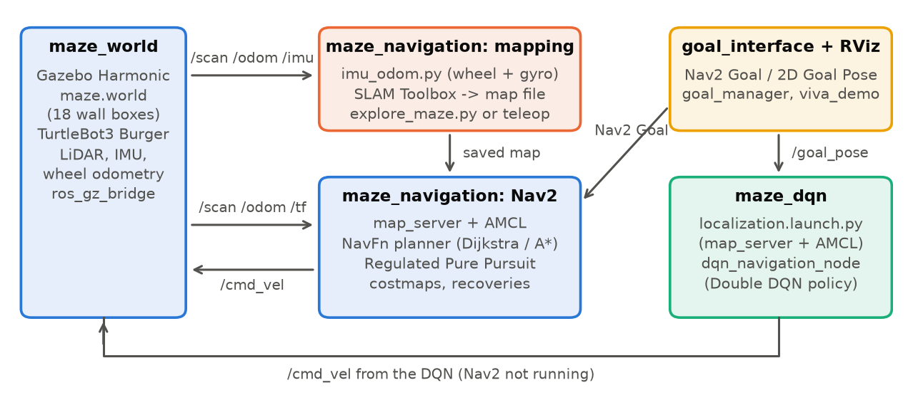

# Autonomous Navigation of TurtleBot3 Burger in Gazebo (ROS 2 Jazzy)

**IE4060 Robotics and Intelligent Systems — Assignment 02**\
**Student:** Seneth Jayathilaka  ·  **Department:** Computer Systems Engineering, Faculty of Computing, SLIIT\
**GitHub repository:** TODO-REPO-LINK  ·  **Date:** 18 October 2026\
**Software:** ROS 2 Jazzy, Gazebo Sim Harmonic, Nav2, SLAM Toolbox, TurtleBot3 Burger

All numbers in this report come from logged simulation runs. Benchmark data:
`docs/test_summary.csv`, `docs/test_results.csv`, `docs/raw_trials.csv`. Longer technical notes,
including every mapping run and the debugging history, are in `docs/report/extended_notes.md`.

## 1. Introduction

The goal is a TurtleBot3 Burger that drives itself to any clicked point of the maze given in the
assignment brief, quickly and without collisions. The system has four ROS 2 packages:
`maze_world` (Gazebo world and robot bring-up), `maze_navigation` (SLAM, Nav2 and localisation),
`goal_interface` (clicked goals and the measured 3-goal demonstration) and `maze_dqn` (the Deep
Q-learning agent). Three navigation methods are compared on the same goals: Nav2 with the NavFn
planner in **Dijkstra** mode, Nav2 with NavFn in **A\*** mode, and **Deep Q-learning (DQN)**.
Figure 1 shows how the packages connect. Gazebo publishes the robot's sensors through
`ros_gz_bridge`; mapping turns them into a saved map; Nav2 or the DQN then drives the robot to
goals clicked in RViz. Nav2 and the DQN are never run together, because both react to clicked
goals.

{width=92%}

| Package | Main files | Started with |
| :-- | :-- | :-- |
| `maze_world` | `worlds/maze.world`, `launch/maze_world.launch.py` | `ros2 launch maze_world maze_world.launch.py` |
| `maze_navigation` | `config/nav2_params.yaml`, `config/slam_params.yaml`, `maps/maze_map.*`, `scripts/imu_odom.py`, `launch/{navigation,slam,localization}.launch.py` | `ros2 launch maze_navigation navigation.launch.py [use_astar:=true]` · `slam.launch.py` · `localization.launch.py odom:=imu` |
| `goal_interface` | `goal_manager.py`, `viva_demo.py` | `ros2 run goal_interface viva_demo` |
| `maze_dqn` | `maze_env.py`, `dqn_model.py`, `train_dqn.py`, `dqn_navigation_node.py`, `models/*.npz` | `ros2 run maze_dqn dqn_navigation_node` |
| `scripts/` | `explore_maze.py`, `align_map_origin.py`, `pad_map.py`, `collect_metrics.py` | `python3 scripts/<name>.py` |

The README gives every command step by step, one terminal tab at a time.

## 2. Maze Design

The arena is 3 m × 3 m with its origin at the centre, divided into 6 × 6 cells of 0.5 m. Walls
are static boxes 0.05 m thick and 0.5 m high (taller than the 0.19 m LiDAR, so every wall is
seen). The layout reproduces Figure 1 of the brief exactly: all 48 half-metre wall segments were
checked against it. Collinear segments are merged into 18 boxes in `maze_world/worlds/maze.world`.
The maze is a *perfect* maze: a breadth-first search over the cells finds all 36 cells connected
by exactly one route between any two. Corridors are 0.45 m wide, so the Burger (radius about
0.1 m) has only about 0.125 m of clearance on each side.

{width=33%}

`maze_world.launch.py` follows the TurtleBot3 Jazzy launch structure: it starts Gazebo with the
world (with the Physics, Sensors, IMU, UserCommands and SceneBroadcaster systems), spawns the
Burger at S, and bridges `/scan`, `/odom`, `/imu`, `/tf`, `/clock` and `/cmd_vel`
(`geometry_msgs/TwistStamped`) to ROS 2.

## 3. Mapping (SLAM) and Localisation

**Exploration.** SLAM Toolbox (online asynchronous mode, `slam.launch.py`) builds the map while
the robot visits all 36 cells. It can be driven by hand with `teleop_twist_keyboard`, or by
`scripts/explore_maze.py`, which does a depth-first tour of the cell graph with slow
stop–turn–drive motion. The script steers using the simulator's pose between moves so that it
never hits a wall; SLAM itself only sees the robot's own sensors.

**Odometry.** In this world the Burger's wheels slip on in-place turns: a 90° turn at 1.2 rad/s
loses about 12° of heading that wheel odometry never sees, and even slow turns lose about 3°.
Over a 7-minute exploration wheel odometry drifted 0.44 m and 18°. The simulated IMU gyro is far
more accurate (0.1° error after a series of fast turns), so `imu_odom.py` combines wheel speed
with the gyro heading. Its odometry stayed within 4 cm of the true position over the same run.

**SLAM settings** (`config/slam_params.yaml`, otherwise SLAM Toolbox defaults): gyro odometry;
laser range limited to 1.5 m, so a small heading error cannot smear distant walls; 2.5 cm grid,
because the walls are only 5 cm thick; and scan matching and loop closure **off**. In this
repetitive maze the scan matcher sometimes registered scans several centimetres off, which
doubled walls and dropped part of the outer wall, while the gyro odometry alone was accurate to
a few centimetres. The map is still built entirely from the LiDAR scans.

**Map quality**, measured against the true walls of `maze.world`:

| Run | Odometry | Scan matching | Other setting | Mean wall error | Wall pixels ≤ 10 cm | Walls mapped | Stray pixels |
| :-- | :-- | :-: | :-- | :-: | :-: | :-: | :-: |
| 1 | wheel | on | — | 2.1 cm | 96.2 % | 97.3 % | 37 |
| 2 | wheel | on | repeat of run 1 | 4.0 cm | 91.4 % | 88.6 % | 212 |
| 5 | wheel + gyro | on | — | 6.0 cm | 75.2 % | 76.1 % | 320 |
| 6 | wheel + gyro | on | repeat of run 5 | 3.3 cm | 95.2 % | 93.0 % | 147 |
| 8 | wheel + gyro | off | — | 2.4 cm | 100 % | 99.9 % | 4 |
| **9 (installed)** | **wheel + gyro** | **off** | **2.5 cm grid** | **1.8 cm** | **100 %** | **100 %** | **5** |

*All runs: same exploration route, laser range 1.5 m, 5 cm grid unless noted. Runs 3, 4 and 7 (other settings, all worse) are in `extended_notes.md`.*

With scan matching on, results varied widely from run to run, even with identical settings
(runs 1–2 and 5–6), and even the best of those maps was missing
0.7 m of the east outer wall and had a doubled wall in one dead end; both broke navigation on
the right side of the maze. The installed map has every wall and no doubled walls. A small
offset of about 2–4 cm remains, mostly from grid quantisation (a wall face falls at an
arbitrary position inside a cell); it was not corrected, because that would mean fitting the
map to the ground truth.

{width=36%}

**Map frame and padding.** The saved map's origin is shifted by the spawn position
(`align_map_origin.py`) so that map and world coordinates coincide, and a 2.5 m border of unknown
cells is added (`pad_map.py`, Section 4.3).

**Localisation.** AMCL uses the likelihood-field model with 500–2000 particles and starts at the
spawn pose. The TurtleBot3 default laser model let the estimate drift by about 0.35 m in the
narrow corridors, so it was sharpened (`sigma_hit` 0.08, `z_rand` 0.2, 120 beams).

## 4. Navigation with Nav2

**Global planner: Dijkstra vs A\*.** NavFn computes a navigation function over the global
costmap. With `use_astar: false` it expands a Dijkstra wavefront; with `use_astar: true` it adds
a Euclidean heuristic. Both find optimal paths on the same costmap; A\* only expands fewer cells.
The mode is selected at launch (`navigation.launch.py use_astar:=true|false`) and was confirmed
on the running planner for every benchmark.

**Local controller.** The TurtleBot3 default DWB controller cut corners and scraped walls in the
0.45 m corridors, so it was replaced by **Regulated Pure Pursuit** with a short 0.15 m lookahead
and 0.15 m/s cruise speed. It follows the corridor-centred path closely and pivots in place at
0.5 rad/s, below the wheel-slip threshold. Angular speed and acceleration limits were lowered in
the velocity smoother and recovery behaviours for the same reason.

**Costmaps.** Robot radius 0.10 m; inflation radius 0.30 m with cost scaling 6.0. This keeps the
corridor centre line well below lethal cost while pulling paths onto it. The global costmap uses
only the static map and inflation (live scan hits a few centimetres off the mapped walls sealed
whole corridors once inflated); the local costmap still uses the LiDAR for unexpected obstacles.

**Key parameters** (`config/nav2_params.yaml`):

| Component | Setting | Value | Why |
| :-- | :-- | :-- | :-- |
| Planner (NavFn) | `use_astar` / `allow_unknown` / tolerance | false or true / false / 0.5 m | Dijkstra or A\*; no paths through unmapped space |
| Controller (RPP) | speed / lookahead / pivot speed | 0.15 m/s / 0.15 m (0.12–0.25) / 0.5 rad/s | tight corridors, no wheel slip |
| Velocity smoother | max ω / angular acceleration | 1.0 rad/s / 2.0 rad/s² | wheel slip on fast turns |
| Costmaps | robot radius / inflation / cost scaling | 0.10 m / 0.30 m / 6.0 | open 0.45 m corridors, centred paths |
| Global / local costmap | layers / resolution | static + inflation / 2 m rolling window with LiDAR | map resolution 0.025 m; local 0.05 m |
| Goal checker | xy / yaw tolerance | 0.10 m / 0.25 rad | goals are cell centres 0.5 m apart |
| AMCL | particles / `sigma_hit` / `z_rand` / beams | 500–2000 / 0.08 / 0.2 / 120 | sharper laser model for narrow corridors |

**Long routes.** At first every goal more than about 6 m of driving away failed. NavFn traces
its final path in half-cell steps and gives up after 4 × (map width in cells) steps, so a path
cannot be longer than about twice the map width, 6.2 m for the 3.1 m map, while the longest
route in the maze is about 12 m. Padding the map with the 2.5 m unknown border makes the costmap
8.1 m wide, raising the limit to about 16 m; `allow_unknown: false` keeps paths out of the
border. Before the fix, all of the long goals in the test below failed. The test drives two
three-leg sequences with each planner; every leg after the first is a 9.4–9.9 m route around
most of the maze, including between two adjacent cells, (1.25, 0.25) and (1.25, −0.25), that a
wall separates:

| Sequence | Planner | Legs reached | Distance driven per leg (m) | Time per leg (s) | Min. clearance (m) |
| :-- | :-- | :-: | :-: | :-: | :-: |
| S → (1.25, −0.25) → (0.75, 0.25) → (1.25, −0.25) | Dijkstra | 3/3 | 2.8 / 9.9 / 9.8 | 31 / 150 / 147 | 0.150 |
| same | A\* | 3/3 | 2.8 / 9.8 / 9.7 | 37 / 149 / 142 | 0.143 |
| S → (1.25, 0.25) → (1.25, −0.25) → (1.25, 0.25) | Dijkstra | 3/3 | 6.8 / 9.5 / 9.5 | 111 / 139 / 139 | 0.152 |
| same | A\* | 2/3 | 5.4 (failed) / 7.5 / 9.4 | 106 / 108 / 143 | 0.000 |

11 of 12 legs reached their goal, ending 0.07–0.11 m from it (true position). The one failure
touched a wall on the way, stopped 1.03 m short and was aborted by Nav2; the next leg then
started from where it stopped, which is why it was shorter.

**Goal interfaces.** In RViz, **Nav2 Goal** sends a goal to Nav2, and **2D Goal Pose**
publishes `/goal_pose`, which both Nav2 and the DQN accept. `goal_manager` also forwards
**Publish Point** clicks after a bounds check. `viva_demo` sends the three test goals in
sequence and records travel time, path length, collisions and clearance for each leg.

**Performance optimisation (travel time and smoothness).** The brief asks for minimal travel
time with smooth, safe motion; in 0.45 m corridors these pull in opposite directions, and the
tuning was driven by measurements:

- *Short paths.* Inflation pulls the global path onto the corridor centre, and the 0.15 m
  lookahead lets the robot round each 90° bend without stopping at the cell centre. Nav2's paths
  were only 8–16 % longer than the shortest possible safe path (η = 86–92 %, Section 6).
- *Reliable long trips.* Padding the map removed the 6 m planning limit, so far goals are
  reached directly instead of failing or needing intermediate goals.
- *Speed vs safety.* Cruise speed is 0.15 m/s, below the Burger's 0.22 m/s maximum. Faster,
  sharper motion was measurably worse: DWB (faster turning, wider sampling) scraped walls, and
  turns above 0.5 rad/s made the wheels slip and AMCL lose the robot, both of which cost far more
  time (recoveries, failed goals) than the slower speed.
- *Smoothness.* The velocity smoother limits acceleration (1.0 m/s², 2.0 rad/s²) and RPP slows
  down on tight curves and near the goal, so the robot accelerates and stops without jerks.

The DQN shows the other side of this trade-off: it drives faster (0.18 m/s, no slowing for
corners). The original DQN was quicker on the long leg but came into contact with walls; the
retrained one keeps its distance and is the fastest method on the long task (Section 6).

## 5. Deep Q-Learning Navigation

**Training environment.** `maze_env.py` is a 2D kinematic model of the same 18 walls (10 Hz,
unicycle motion) with a simulated 360-beam LiDAR. A collision is counted when the robot centre
comes within 0.12 m of a wall.

**MDP.** *State* (39 values): the LiDAR min-pooled into 36 sectors of 10°, the distance and
bearing to the target, and the previous action. *Actions* (5): forward 0.18 m/s, rotate in place
±1.0 rad/s, soft turns (0.14 m/s, ±0.35 rad/s). *Reward*: +30 at the goal, −20 for a collision,
−5 at timeout, otherwise 10 × the progress along the maze corridors (not straight-line distance,
which would reward driving into walls) − 0.05, and −0.2 near walls. Two variants were trained:
the **final-goal DQN**, whose target is the goal itself, and the **subgoal DQN**, whose target
is the next cell centre on the shortest grid route (a learned local controller under a simple
route planner).

**Algorithm.** Double DQN with a NumPy network (39-128-128-64-5, ReLU), Huber loss, Adam
(learning rate 5 × 10⁻⁴), γ = 0.98, batch 64, 100 000-transition replay buffer, target network
update every 1000 steps, ε decaying from 1.0 to 0.05 per episode, and a curriculum that starts
with goals one cell away. The best evaluated weights are kept. The first version never
succeeded; the causes were ε decaying per gradient step instead of per episode, episodes too
short for the far goals, no true in-place turn, and a straight-line progress reward.

**Training results** (2D model, `dqn_final_evaluation.csv`; Goals A–C = G1–G3 from the spawn):

| Variant | Goal A | Goal B | Goal C | Random 1–2 cells | 3–5 cells | 8–10 cells | 22–24 cells |
| :-- | :-: | :-: | :-: | :-: | :-: | :-: | :-: |
| Final-goal DQN (3000 episodes) | 0/1 | 0/1 | 0/1 | 39/50 | 16/50 | 0/50 | 0/50 |
| Subgoal DQN (2200 episodes) | 0/1 | 1/1 | 1/1 | 44/50 | 30/50 | 25/50 | 22/50 |
| Subgoal DQN, retrained (0.15 m margin) | 0/1 | 1/1 | 1/1 | 47/50 | 39/50 | 43/50 | 48/50 |

The final-goal DQN handles nearby goals but gets trapped when the goal is behind a wall,
rotating back and forth in place. The subgoal DQN reaches far goals because the route planner
always gives it a reachable next cell. Figure 4 shows that training was unstable: the subgoal
agent peaked at episode 1300 and degraded again as the curriculum moved to longer routes, so the
best evaluation was kept rather than the last weights.

**Retraining with a safety margin.** The original agents counted a collision only when the robot
*centre* came within 0.12 m of a wall, barely outside the Burger's body (radius about 0.105 m),
so they learned to run close to walls. The subgoal DQN was therefore retrained from scratch with
the margin raised to **0.15 m**, in-place turns slowed from 1.0 to **0.5 rad/s** (below the
wheel-slip threshold of Section 3) and the wall penalty starting at 0.20 m. Four seeds were
trained in parallel; seed 1 was chosen by its random full-maze success (82 % at episode 2200,
against 38 % for the original), not by the three test goals, which are the benchmark goals. Its
evaluation (last table row) is stronger at every distance despite the stricter margin, most of
all on long routes (48/50 against 22/50). `dqn_navigation_node -p model:=safe` loads it, with
its settings read from `dqn_subgoal_safe_weights.json`.

{width=88%}

**Deployment.** `dqn_navigation_node` builds the same state from `/scan` and the robot pose and
publishes velocity commands at 10 Hz. Its pose comes from AMCL started on its own
(`localization.launch.py`, map server + AMCL only, so Nav2 does not also react to the goals),
using the gyro odometry, because the DQN's wall contacts and fast turns make the wheels slip.

**Safety shield.** A first attempt without retraining (`safety_shield:=true`) used action
masking: the DQN still ranks the actions, but moves towards an obstacle within 0.25 m ahead or
0.17 m to the side are removed and commands are slowed near walls (evaluated in Section 6).

## 6. Results

**Protocol.** Every method runs the same three tasks three times: **S → G1**, **G1 → G2** and
**G2 → G3**. Before each leg the test harness (`viva_demo fixed_starts:=true`) places the robot at
exactly the same start pose in Gazebo, tells AMCL that pose and clears Nav2's costmaps, so all
trials of a task are identical (the navigation stack never uses the simulator's pose). *Time* is
simulation time to the result; a leg fails after 240 s (Nav2) or 180 s (DQN). *Path* is the
distance driven (from odometry). The *reference length* is the shortest collision-free path for a
robot of radius 0.10 m (the Nav2 footprint) from the start to the success circle around the goal
(0.10 m for Nav2, 0.15 m for the DQN), computed exactly from the walls of `maze.world` with a
visibility graph (`collect_metrics.py`). *Efficiency* η = reference ÷ path, so a robot that keeps
0.10 m from the walls scores at most 100 %; above 100 % means it cut closer than that. A
*collision event* is a LiDAR range below the sensor's 0.12 m minimum.

**DQN judged against ground truth.** A DQN leg counts as reached when its AMCL pose is within
0.15 m of the goal. Every DQN leg was also checked against the simulator's true position (for
measurement only): AMCL stayed within 0.15 m of it while driving, the subgoal DQN's legs truly
ended 0.13–0.21 m from the goal, and failed legs ended 0.7–1.2 m from the goal. An
earlier run, in which the localisation launch silently failed to load the map, reported false
successes and was discarded.

**Table — mean ± standard deviation over successful trials** (all on the installed map):

| Method | Task | Success | Time (s) | Path (m) | Ref. (m) | η (%) | Collisions | Min. clearance (m) |
| :-- | :-- | :-: | :-: | :-: | :-: | :-: | :-: | :-: |
| Nav2 Dijkstra | S → G1 | 3/3 | 15.1 ± 0.2 | 0.75 ± 0.02 | 0.68 | 90.1 ± 1.9 | 0 | 0.170 |
| Nav2 Dijkstra | G1 → G2 | 3/3 | 88.1 ± 2.0 | 5.35 ± 0.02 | 4.61 | 86.2 ± 0.3 | 0 | 0.146 |
| Nav2 Dijkstra | G2 → G3 | 3/3 | 15.1 ± 0.2 | 0.75 ± 0.01 | 0.68 | 89.6 ± 1.4 | 0 | 0.169 |
| Nav2 A\* | S → G1 | 3/3 | 15.3 ± 0.1 | 0.75 ± 0.01 | 0.68 | 89.6 ± 1.3 | 0 | 0.163 |
| Nav2 A\* | G1 → G2 | 3/3 | 85.9 ± 0.5 | 5.30 ± 0.02 | 4.61 | 87.0 ± 0.3 | 0 | 0.136 |
| Nav2 A\* | G2 → G3 | 3/3 | 14.9 ± 0.3 | 0.76 ± 0.02 | 0.68 | 89.3 ± 2.7 | 0 | 0.167 |
| DQN subgoal | S → G1 | 3/3 | 14.1 ± 3.1 | 0.66 ± 0.02 | 0.63 | 94.9 ± 3.0 | 0 | 0.138 |
| DQN subgoal | G1 → G2 | 3/3 | 68.3 ± 3.1 | 5.25 ± 0.03 | 4.56 | 86.9 ± 0.4 | 17 | 0.000 |
| DQN subgoal | G2 → G3 | 3/3 | 10.6 ± 1.4 | 0.73 ± 0.03 | 0.63 | 85.5 ± 3.5 | 3 | 0.120 |
| DQN subgoal + shield | S → G1 | 3/3 | 17.2 ± 7.2 | 0.65 ± 0.05 | 0.63 | 96.8 ± 8.1 | 0 | 0.133 |
| DQN subgoal + shield | G1 → G2 | 0/3 | — | — | 4.56 | — | 37 | 0.000 |
| DQN subgoal + shield | G2 → G3 | 3/3 | 14.3 ± 4.4 | 0.71 ± 0.01 | 0.63 | 88.0 ± 1.8 | 0 | 0.125 |
| **DQN subgoal, retrained** | S → G1 | 3/3 | 10.7 ± 0.4 | 0.68 ± 0.00 | 0.63 | 91.4 ± 0.6 | 0 | 0.128 |
| **DQN subgoal, retrained** | G1 → G2 | 3/3 | 54.7 ± 0.9 | 5.43 ± 0.04 | 4.56 | 84.0 ± 0.6 | 0 | 0.125 |
| **DQN subgoal, retrained** | G2 → G3 | 3/3 | 9.2 ± 0.2 | 0.70 ± 0.01 | 0.63 | 89.4 ± 1.6 | 0 | 0.166 |
| DQN final goal | S → G1 | 3/3 | 7.1 ± 0.9 | 0.62 ± 0.02 | 0.63 | 101.7 ± 2.8 | 0 | 0.141 |
| DQN final goal | G1 → G2 | 0/3 | — | — | 4.56 | — | 86 | 0.000 |
| DQN final goal | G2 → G3 | 3/3 | 8.2 ± 5.1 | 0.91 ± 0.47 | 0.63 | 79.4 ± 31.6 | 1 | 0.000 |

*Collisions are summed over three trials. Min. clearance is the smallest LiDAR range over all
three trials (0.000 = a reading below the 0.12 m sensor minimum).*

{width=92%}

**Discussion.**

- **Dijkstra vs A\*.** With identical starts both planners are very repeatable (time spread
  0.1–2 s) and found the same routes: mean path lengths differ by at most 0.05 m and times by at
  most 2.2 s. In a maze this small, A\*'s smaller search gives no measurable gain in travel time
  or path length; its advantage would show in planning time on much larger maps. Both were
  collision-free (minimum clearance 0.136 m) and drove paths only 8–16 % longer than the
  shortest safe path.
- **Original DQN vs Nav2.** The original subgoal DQN reached all 9 goals and was faster than
  Nav2 on the long task (68 s against 86–88 s; it drives at 0.18 m/s and does not slow for
  corners), but had 20 collision events (17 on the long task) against 0: in training a collision
  only counted when the robot *centre* came within 0.12 m of a wall.
- **Safety shield.** The shield did not solve this. It kept the short tasks contact-free, but on
  G1 → G2 it failed all three trials (37 events): with a wall close on one side, blocking forward
  motion left the robot rotating slowly in place against that wall. A diagnostic run showed that
  most contacts with the shield happened *during in-place rotations*, which the shield cannot
  forbid without leaving the robot stuck. Masking actions after training cannot give a policy a
  safety margin it never learned; the margin has to be in the training.
- **Retrained DQN (the final DQN result).** Training with the 0.15 m margin and 0.5 rad/s turns
  fixed it: **9/9 goals, 0 collision events** (minimum clearance 0.125 m). It was faster than
  Nav2 on every task (S → G1 10.7 s, G1 → G2 54.7 s, G2 → G3 9.2 s, against about 15, 86–88 and
  15 s) and the fastest of all methods on the long task, with very small spread across trials. Its paths are slightly longer than
  Nav2's on the long task (η 84 % against 86–87 %), because it stays nearer the corridor centre
  while driving faster. The ground-truth check confirmed every leg ended 0.15–0.20 m from the
  goal (the success rule is 0.15 m on the AMCL pose, itself about 0.1 m off).
- **Final-goal DQN.** It reached the two goals in direct view (S → G1, G2 → G3, and faster than
  any other method there, driving straight at the goal) but never the goal behind walls
  (G1 → G2, 0/3, 86 events). A purely reactive policy cannot solve a maze; this is the baseline
  that motivates the subgoal design, where a route planner supplies reachable targets.

**Summary of the methods.**

| | Nav2 Dijkstra | Nav2 A\* | DQN subgoal | + shield | **DQN retrained** | DQN final goal |
| :-- | :-: | :-: | :-: | :-: | :-: | :-: |
| Goals reached (9 legs) | 9 | 9 | 9 | 6 | **9** | 6 |
| Long task G1 → G2, mean time | 88.1 s | 85.9 s | 68.3 s | — (0/3) | **54.7 s** | — (0/3) |
| Collision events (9 legs) | 0 | 0 | 20 | 37 | **0** | 87 |
| Path efficiency η (task means) | 86–90 % | 87–90 % | 86–95 % | 88–97 % | 84–91 % | — |
| Needs training | no | no | yes | yes | yes | yes |
| Plans a global route | yes | yes | grid route + learned control | same | same | no |

**Limitations.** Three trials per task show the spread but are too few for significance tests;
all results are from simulation; the DQN was trained in a simplified 2D model; and the collision
measure also counts near-contacts. Results of the earlier protocol (chained legs, cell-centre
reference) are kept in `extended_notes.md`.

## 7. Challenges and Solutions

1. **Bring-up on Jazzy.** The world lacked Gazebo system plugins, the robot was not spawned, and
   Nav2 in Jazzy needs extra servers and `TwistStamped` commands; all were added.
2. **Wheel slip and odometry drift.** Fast turns lost up to 12° per 90°. Turns were slowed
   everywhere, and mapping uses wheel speed plus gyro heading.
3. **Unreliable SLAM maps.** Maps from repeated runs ranged from 2.1 to 6.0 cm mean error, with
   missing or doubled walls. Gyro odometry with scan matching off gave a complete map in both runs.
4. **Narrow corridors.** DWB scraped walls and live scan obstacles sealed corridors; the
   controller, inflation and global costmap were changed as described in Section 4.
5. **Goals over 6 m away failed.** NavFn's path-length limit, fixed by padding the map.
6. **DQN training and deployment.** Four training bugs were fixed (Section 5). In Gazebo, a
   launch problem left AMCL without a map, so the DQN silently fell back to drifting odometry and
   reported false successes; checking every leg against the true position exposed and fixed it.
7. **Honest, fair measurement.** An earlier benchmark script produced numbers from fixed
   multipliers; it was replaced by measurement inside `viva_demo`. A first measured protocol
   chained the legs (each started where the last ended) and used the cell-centre route as the
   reference, which gave unequal starts and efficiencies above 100 %; it was replaced by fixed
   starts and the shortest safe path as the reference.
8. **DQN safety.** An action-masking shield was added and measured; it did not remove the
   contacts (Section 6). Retraining with a 0.15 m collision margin and 0.5 rad/s turns did:
   the retrained DQN reached all goals with no contact.

## 8. Possible Improvements

1. Use the retrained subgoal DQN as a Nav2 controller plugin on the NavFn path, keeping Nav2's
   recovery behaviours, and stabilise its training (it peaked at episode 2200 and degraded
   afterwards), e.g. with a lower learning rate or prioritised replay.
2. Train in Gazebo (or model wheel slip and LiDAR noise in the 2D environment) to close the gap
   between simulators.
3. Fuse the IMU into the odometry used by Nav2 and AMCL too (e.g. a `robot_localization` EKF).
4. Raise Nav2's cruise speed towards the Burger's 0.22 m/s limit on straight sections, compare
   Smac planners and MPPI, and remove the 2–4 cm map offset with sub-cell wall fitting.

## References

1. Macenski, S., Martín, F., White, R., Ginés Clavero, J. (2020). The Marathon 2: A Navigation System. IROS 2020.
2. Macenski, S., Jambrecic, I. (2021). SLAM Toolbox: SLAM for the dynamic world. *JOSS*, 6(61), 2783.
3. Mnih, V., et al. (2015). Human-level control through deep reinforcement learning. *Nature*, 518, 529–533.
4. van Hasselt, H., Guez, A., Silver, D. (2016). Deep Reinforcement Learning with Double Q-learning. AAAI.
5. Open Navigation LLC. Nav2 documentation (Jazzy). https://docs.nav2.org/
6. ROBOTIS. TurtleBot3 e-Manual. https://emanual.robotis.com/
